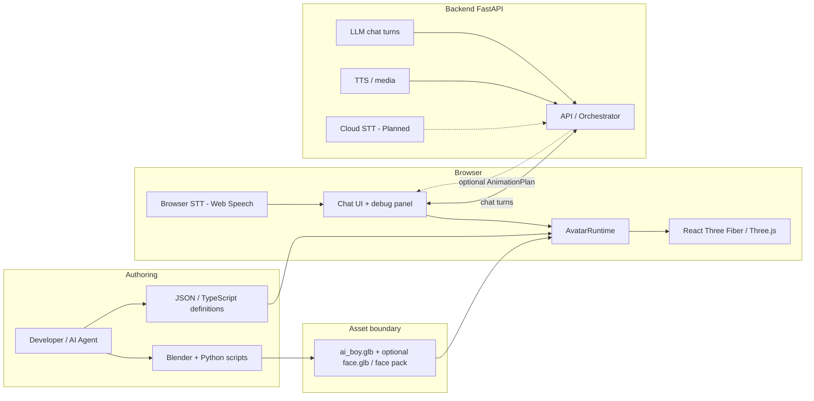
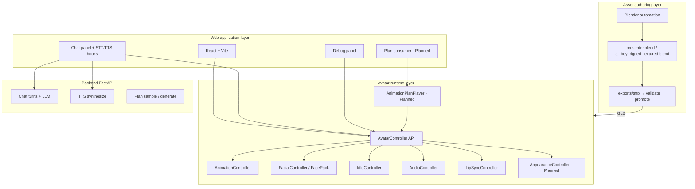
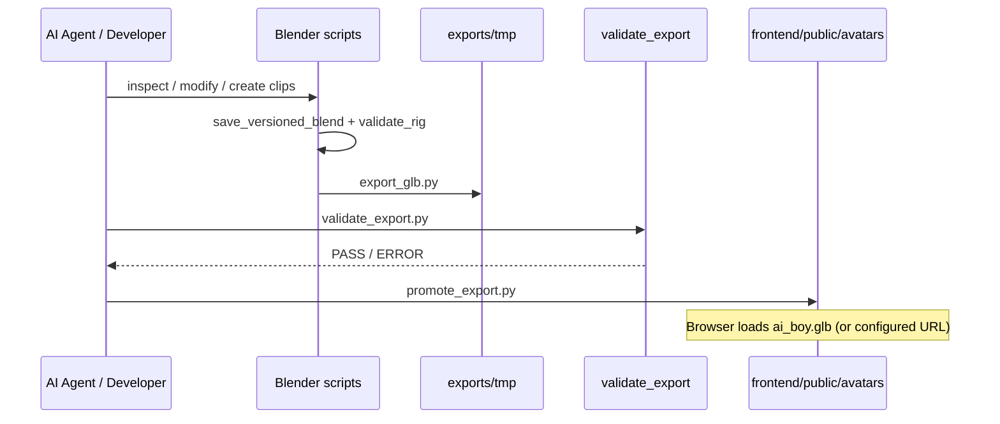
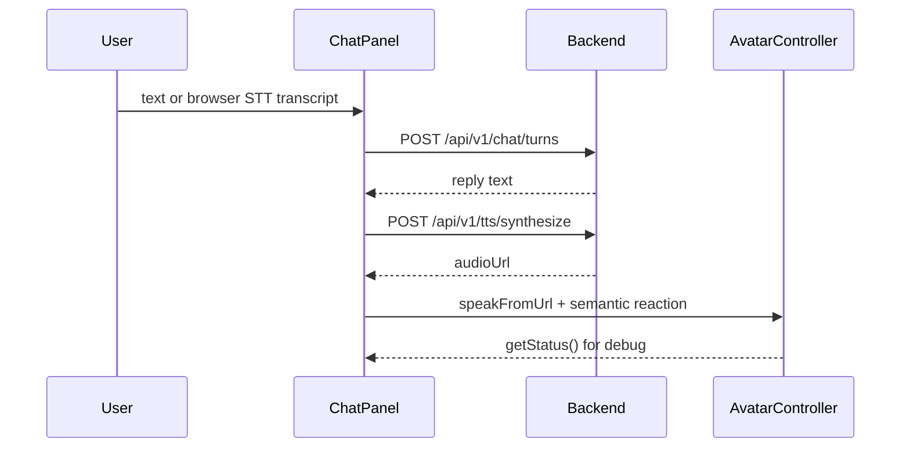
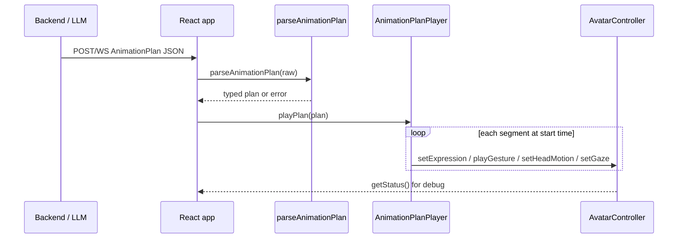
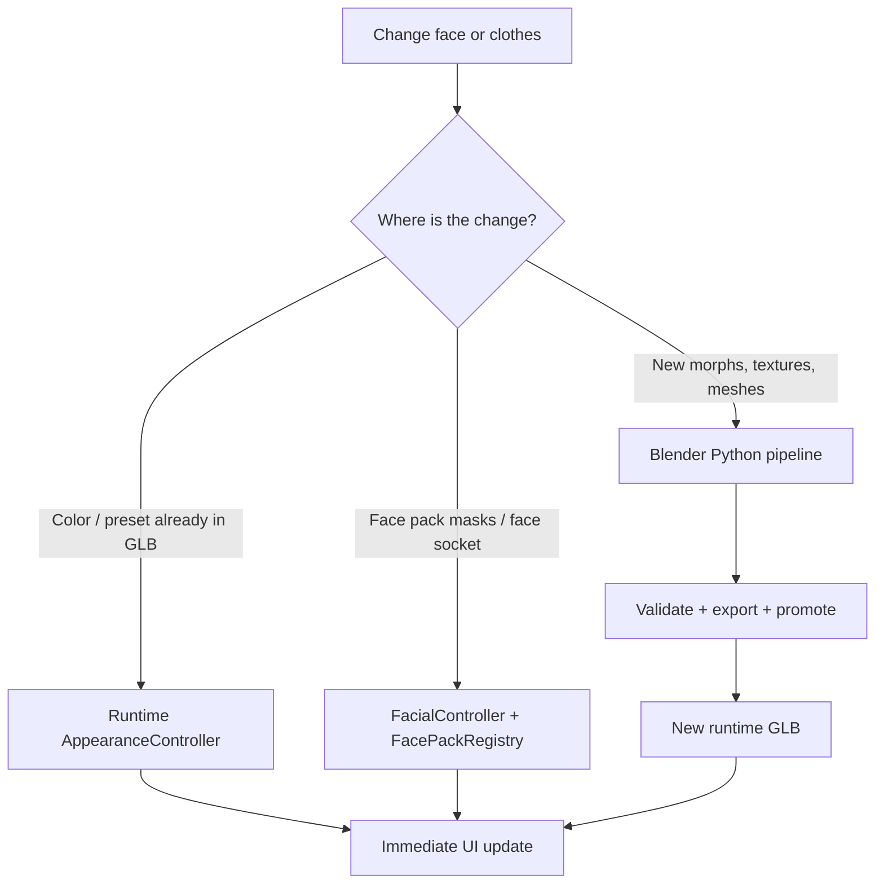
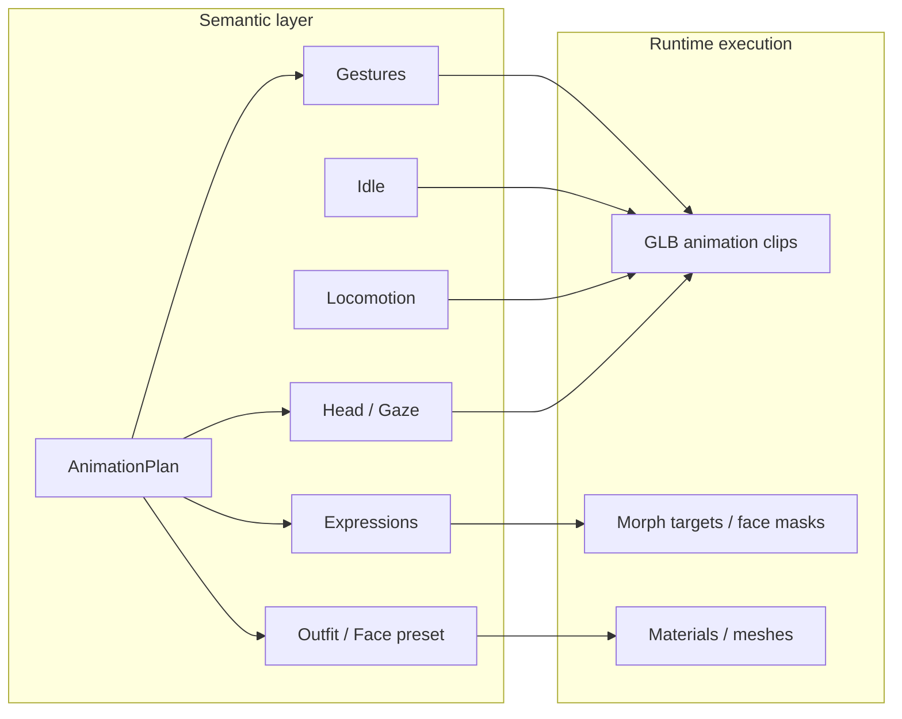

# Stylized Chatbot Avatar — Overall Architecture

This document is the **project architecture** for an interactive **stylized** 3D chatbot avatar (Snapchat / Bitmoji-like look). It describes system boundaries, data flows, and how the semantic runtime extends to chat (text/voice), customized looks, and optional timed instruction plans.

**Status as of 2026-11-11:** Chat (text) + TTS + browser STT are shipped. Default runtime body is `ai_boy.glb`. `AnimationPlanPlayer`, wardrobe/appearance presets, and cloud/backend STT remain **Planned**. Implementation stays incremental (learn-by-building). Items marked **Planned** are approved architecture, not unfinished guesses.

**Product pivot (Phase 0):** primary UX is **conversation** (text first, then voice). The earlier “news presenter + AnimationPlan” path remains a valid **optional scripted mode**, not the main product story.

Related docs:

- [docs/architecture.md](architecture.md) — layer summary
- [docs/overall_architecture_burmese.md](overall_architecture_burmese.md) — Burmese translation of this document
- [docs/avatar-art-contract.md](avatar-art-contract.md) — stylized look + bone/clip/morph contract
- [docs/blender-pipeline.md](blender-pipeline.md) — Blender → GLB automation
- [docs/avatar-spec.md](avatar-spec.md) — asset and semantic API notes
- [AGENTS.md](../AGENTS.md) — one-step implementation rule for coding agents

---

## 1. Product Goal

Build a browser-based **interactive chatbot avatar** that:

1. Loads a **stylized** humanoid from a validated **GLB** (skeleton + motion; looks swapable in Three.js)
2. Plays **semantic** behaviors (idle, talk reaction, gestures, expressions, head, gaze, locomotion, audio)
3. Converses with the user via **text** first, then **voice in/out** (STT / TTS) without exposing bones/clips to the UI
4. Optionally accepts a timed **AnimationPlan** for scripted performances (legacy presenter path)
5. Supports **visual customization** (materials / accessories / face packs) through clear asset + runtime boundaries
6. Stays maintainable for a developer + AI coding agent (Blender Python for structure, TypeScript/JSON for behavior)

---

## 2. Core Principles

1. **Edit sources, not compiled GLBs** — JSON, TypeScript, and Blender Python are primary; runtime GLBs (`ai_boy.glb`, optional `presenter.glb` / `face.glb`) are exports.
2. **Blender authors assets; the browser runs them** — no Blender in the request path.
3. **Semantic commands only** — `playGesture("emphasize")`, `setExpression("serious")`, never bone indexes or clip array positions.
4. **Separate look from behavior** — mesh/materials/morphs/face packs vs gestures/idle/locomotion/plans.
5. **Inspect → backup → modify → validate → export temp → promote** for asset changes.
6. **Backend sends intents, not renderer details** — chat replies, TTS audio URLs, emotion/gesture/head/gaze (+ later outfit/face presets), never Mixamo bone paths or Three.js objects.
7. **Grow in phases** — local runtime first; chat → TTS → STT → skins (see roadmap below).
8. **Stylized over photoreal** — cartoon proportions and soft/flat materials; see [avatar-art-contract.md](avatar-art-contract.md).

---

## 3. System Context



### Roadmap (learning-sized phases)

| Phase | Focus | Status |
| --- | --- | --- |
| 0 | Product goal + art/naming contract | Done |
| 1 | Stylized avatar art + framing; runtime GLB (`ai_boy.glb`) | Done |
| 2 | Text chat loop → avatar talk/idle | Done |
| 3 | TTS → `AudioController` + lip sync / mouth | Done |
| 4 | Voice in — browser STT (Web Speech mic) | Done |
| 4b | Cloud / backend STT | Planned |
| 5 | Three.js skins / material presets (`AppearanceController`) | Planned |
| 6 | Polish (streaming, barge-in, richer gestures, plan player UX) | Planned |

---

## 4. Logical Architecture



| Layer | Responsibility |
| --- | --- |
| Web | Pages, chat UI, debug UI, config, STT mic hook; later plan fetch UI |
| Avatar runtime | Semantic API → mixers, morphs/face packs, bones, idle, locomotion, audio, lip sync |
| Definitions | Gesture/expression/idle/locomotion names, material/outfit presets, schemas |
| Blender authoring | Rig, mesh, facial morphs or face assets, clothing, export |
| Backend (shipped core) | Chat turns (LLM), TTS, sample/generate `AnimationPlan` helpers |
| Backend (planned) | Cloud STT; richer plan orchestration consumed by a plan player |

---

## 5. Repository Layout (actual)

The npm app lives in **`frontend/`** (not an `apps/` monorepo). The API lives in **`backend/`**.

```text
AI_3D_Avatar/
├── frontend/                              # Vite + React + R3F
│   ├── public/avatars/
│   │   ├── ai_boy.glb                     # Default runtime body (avatarConfig.modelUrl)
│   │   ├── presenter.glb                  # Contract stand-in / alternate
│   │   ├── face.glb                       # Optional face socket asset
│   │   └── face/masks/                    # Optional expression face-pack textures
│   ├── public/audio/
│   └── src/
│       ├── features/avatar/               # R3F scene + debug UI
│       ├── features/chat/                 # Chat panel, STT, TTS reaction helpers
│       ├── services/avatar/               # AvatarRuntime, controllers
│       ├── types/                         # AvatarController, AnimationPlan
│       └── constants/
├── backend/                               # FastAPI clean architecture
│   └── app/                               # chat, tts, plans, health routes
├── blender/
│   ├── source/presenter.blend             # Learning / contract authoring source
│   ├── scripts/                           # inspect, validate, export, modify, …
│   ├── definitions/                       # bone rename maps, etc.
│   └── exports/                           # tmp + candidates (e.g. ai_boy_rigged_textured.*)
├── docs/
│   ├── Overall_Architecture.md            # This document (English)
│   └── overall_architecture_burmese.md    # Burmese translation
├── AGENTS.md
└── README.md
```

---

## 6. End-to-End Data Flows

### 6.1 Asset pipeline (Blender → browser)



### 6.2 Chat turn → speak (shipped)



### 6.3 Backend instruction array → avatar performance (target)



**Status today:** `AnimationPlan` types and `parseAnimationPlan` exist (frontend + backend). Backend can serve sample/generate plan helpers. **AnimationPlanPlayer** and a first-class frontend “play plan” consumer are **Planned**.

### 6.4 Appearance change (face / clothes)



---

## 7. Semantic Runtime API

UI, debug panel, chat adapters, plan player, and future backend adapters must use only this surface (names may grow; indexes never appear):

| Command | Purpose | Status |
| --- | --- | --- |
| `playGesture(name)` | One-shot body gesture | Done |
| `setExpression(name)` | Facial morph / face-pack preset | Done |
| `setHeadMotion(name)` | Nod / turn / tilt / shake | Done |
| `setGaze(target)` | Look target | Done |
| `setIdle(name)` | Looping idle pose | Done |
| `startLocomotion(name)` / `stopLocomotion()` | In-place walk cycles | Done |
| `startSpeaking()` / `stopSpeaking()` | Speech state hooks | Done |
| `loadAudio` / `playAudio` / `pauseAudio` / `stopAudio` | Local audio | Done |
| `unlockAudio()` / `speakFromUrl(url)` | TTS-friendly playback | Done |
| `reset()` | Return to idle baseline | Done |
| `playPlan(plan)` | Run timed segment array | **Planned** |
| `setOutfit(id)` / `setFacePreset(id)` | Appearance presets | **Planned** |

Current gesture / expression / idle / locomotion / head / gaze name sets live in `frontend/src/types/animation.ts` and `AnimationRegistry.ts`.

---

## 8. Backend Instruction Plans

### 8.1 Contract

Backend (or a mock file) sends an **array of timed segments**, not a list of bone keyframes.

```json
{
  "segments": [
    {
      "start": 0,
      "end": 2.0,
      "emotion": "serious",
      "gaze": "camera"
    },
    {
      "start": 2.0,
      "end": 4.5,
      "gesture": "emphasize",
      "headMotion": "nod",
      "emotion": "serious"
    },
    {
      "start": 4.5,
      "end": 7.0,
      "emotion": "positive",
      "gesture": "openHand",
      "headMotion": "tiltLeft"
    }
  ]
}
```

Optional later fields (same semantic style):

```json
{
  "start": 0,
  "end": 10,
  "emotion": "neutral",
  "outfit": "suit_navy",
  "facePreset": "presenter_a"
}
```

### 8.2 Rules

- Times are seconds from plan start (`start` ≤ `end`).
- Unknown semantic names are rejected by `parseAnimationPlan`.
- Player maps each segment onto `AvatarController` at `start` (and may clear/replace at `end` as designed).
- Backend must not send morph indexes, clip indexes, or Three.js node names.

### 8.3 Implementation stages

| Stage | Deliverable |
| --- | --- |
| Done | `AnimationPlan` / `AnimationSegment` types |
| Done | `parseAnimationPlan` + unit tests (frontend + backend) |
| Done | Backend plan helpers (`/plans/sample`, generate routes) |
| Done | Chat + TTS HTTP used by the chat UI (primary product path) |
| Planned | `AnimationPlanPlayer` + `playPlan` on controller |
| Planned | Debug “load sample plan” button / frontend plan consumer |
| Later | LLM-timed plans aligned to TTS clock; streaming / barge-in |

---

## 9. Customized Face

### 9.1 Goals

- Swap or refine the character face without rewriting the runtime
- Drive expressions through stable morph target names **or** face-pack masks
- Optionally select a **face preset** from UI/backend when multiple faces exist

### 9.2 Architecture split

| Concern | Owner |
| --- | --- |
| Face mesh, textures, real blendshapes | Blender (authoring) |
| Morph name contract | `blender/scripts/contracts.py` + docs |
| Expression weights / face-pack masks | `FacialController`, `FacePackRegistry`, `FaceMaskLayer` |
| Optional separate face mesh on `Head` | `avatarConfig.faceUrl` + runtime attach |
| Choosing preset “Face A/B” | **Planned** `AppearanceController` / definitions JSON |

### 9.3 Paths to a custom face

1. **Author morphs on current character** — sculpt real shape keys in Blender; keep contract names; export → promote.
2. **Replace character** — import rigged GLB/FBX (e.g. Mixamo), rename bones, add morphs/textures, release (AI Boy path).
3. **Face socket + face pack (shipped option)** — separate `face.glb` and/or mask textures; `useFacePack` toggles mask expressions for blank stylized heads (painted characters leave it off).
4. **Runtime face preset (Planned)** — multiple head meshes or morph/texture sets selected by `setFacePreset("id")`.

### 9.4 Constraints

- Mixamo bodies often lack production facial morphs; stubs / face pack cover contract and UX.
- Photo-to-face pipelines stay **outside** the runtime (external tool → import pipeline).
- Do not scatter morph target indexes in React components.

---

## 10. Avatar Clothing

### 10.1 Goals

- Change outfit appearance without breaking the rig or semantic API
- Prefer **runtime overrides** for color/presets when the GLB already exposes materials
- Use Blender when clothes need new meshes, UVs, or texture sets

### 10.2 Architecture split

| Concern | Owner |
| --- | --- |
| Clothing meshes, UVs, textures, material slots | Blender |
| Material naming (`Suit`, `Shirt`, …) | Asset contract / definitions |
| Recolor / switch preset at runtime | **Planned** `AppearanceController` |
| Bake new materials into GLB | `modify_materials.py` + export pipeline |

### 10.3 Paths to change clothes

1. **Color change (simple)** — Blender `modify_materials.py` or runtime material color override (**Planned** in UI).
2. **Outfit preset** — named material/texture sets or hidden mesh groups; `setOutfit("suit_navy")`.
3. **Full wardrobe swap** — separate clothing meshes skinned to the same armature; show/hide or swap in runtime.

### 10.4 Constraints

- A single atlas texture that mixes skin + cloth limits recoloring; split materials in Blender when wardrobe matters.
- Backend may request `outfit` in a plan segment; it must not send shader graphs or texture URLs into the mixer blindly (validate against an allow-list).

---

## 11. Blender Automation Strategy

Authoring stays programmable:

```text
inspect_scene → modify_* / create_animation / apply_rename_map
  → save_versioned_blend → validate_rig
  → export_glb (tmp) → validate_export → promote_export
```

Key scripts live under `blender/scripts/` (MVP docs that say `automation/` mean this folder). See [docs/blender-pipeline.md](blender-pipeline.md).

npm helpers from `frontend/`: `avatar:inspect`, `avatar:validate-rig`, `avatar:export`, `avatar:validate-export`, `avatar:promote`, `avatar:release`, `avatar:scaffold`, `avatar:export-mixamo`, `avatar:import-rigged`.

---

## 12. Animation and Appearance Strategy



- **Clips** — idle, gestures, head motions, locomotion (Blender or stub generators).
- **Morphs / face packs** — facial expressions (and mouth amplitude / lip sync during TTS).
- **Materials/meshes** — clothes and face look.
- **Plans** — timed orchestration from backend/LLM (optional path).

---

## 13. Phase Map

| Track | Focus | Backend? | Status |
| --- | --- | --- | --- |
| **Foundation** | GLB load, semantic API, idle/gesture/expression/head, local audio, debug panel, Blender pipeline | No | Done |
| **Conversation** | Chat UI, FastAPI chat turns + LLM, TTS playback, browser STT, reply reactions, lip sync | Yes | Done |
| **Motion expansion** | Richer gestures, idle variants, locomotion | No | Done (core set) |
| **Character / face** | AI Boy body GLB; optional face socket + face pack | No | Done (baseline); polish ongoing |
| **Next architecture slices** | `AnimationPlanPlayer`, sample-plan UI, appearance presets, cloud STT | Partial / Planned | Next |
| **Later polish** | Streaming, barge-in, subtitles, multilingual | Yes | Planned |

Conversation must keep driving the avatar with semantic fields only. Scripted `AnimationPlan` remains optional.

---

## 14. Web and Runtime Notes

- Per-frame work stays in `AvatarRuntime.update` / `useFrame` — not React `setState` every frame.
- Debug panel samples status a few times per second and only calls `AvatarController`.
- Only the avatar feature constructs `AvatarRuntime` (see `features/avatar`). Chat uses the same controller via hooks/helpers.
- Missing clips/morphs/materials produce warnings and safe no-ops where possible.

---

## 15. Testing and Validation

- **Unit:** definition validation, `parseAnimationPlan`, registries, state machine, face pack registry.
- **Blender:** `inspect_scene`, `validate_rig`, `validate_export` (PASS/WARNING/ERROR lines).
- **Manual:** avatar loads, gestures, expressions, idle/locomotion, chat + TTS + mic STT, plan playback (when built), outfit/face presets (when built).
- **Rule:** failed export validation must not promote over a working runtime GLB.

---

## 16. Engineering Rules

- Do not put all avatar logic in one React component.
- Do not use clip indexes or raw morph indexes in UI/backend payloads.
- Do not overwrite authoring `.blend` files or runtime GLBs without backup/validation.
- Do not launch Blender for ordinary browser interactions.
- Prefer runtime material/outfit presets for clothes color; use Blender for structural clothing/face work.
- Backend plans and chat reactions are semantic only.

---

## 17. Definition of Done (architecture milestones)

### Foundation + conversation (shipped)

- [x] Local Vite app loads runtime GLB (`ai_boy.glb` default)
- [x] Semantic runtime API + debug panel
- [x] Blender inspect → validate → export → promote pipeline
- [x] `AnimationPlan` types + `parseAnimationPlan`
- [x] FastAPI chat turns + TTS used by chat UI
- [x] Browser STT mic on chat panel
- [x] Documented overall architecture (this file + Burmese)

### Planned next

- [ ] `AnimationPlanPlayer` + `playPlan`
- [ ] Debug/mock plan from JSON file or paste
- [ ] Appearance API: outfit and/or face preset
- [ ] Cloud / backend STT (optional; browser STT already works)
- [ ] Asset guidance polish: split materials for clothes; richer face presets

---

## 18. Final Division of Responsibilities

| System | Owns |
| --- | --- |
| **Blender** | Geometry, rig, facial morph authorship, clothing meshes/textures |
| **Blender Python** | Inspect, safe modify, validate, export |
| **GLB** | Runtime distribution format |
| **JSON / TS definitions** | Names, presets, schemas |
| **AvatarRuntime** | Semantic → clips/morphs/face packs/materials/audio |
| **React** | UI, chat lifecycle, STT mic, plan fetch UI (when built) |
| **Backend** | Chat orchestration, LLM, TTS; optional plan helpers |
| **LLM** | Chat replies; later optional high-level semantic plans |

The objective is not to rebuild DCC tools in the browser. The objective is a **clear boundary**: author looks in Blender, drive behavior with semantic commands (and optional plans), and keep the backend ignorant of bones and shaders.
