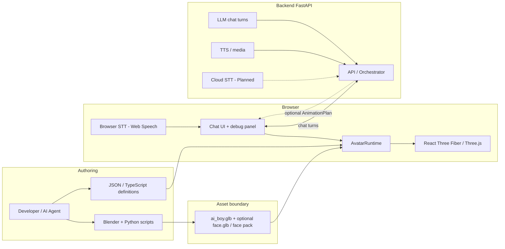
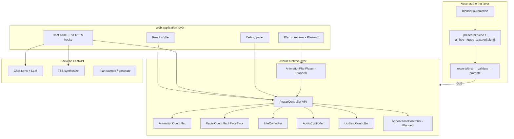
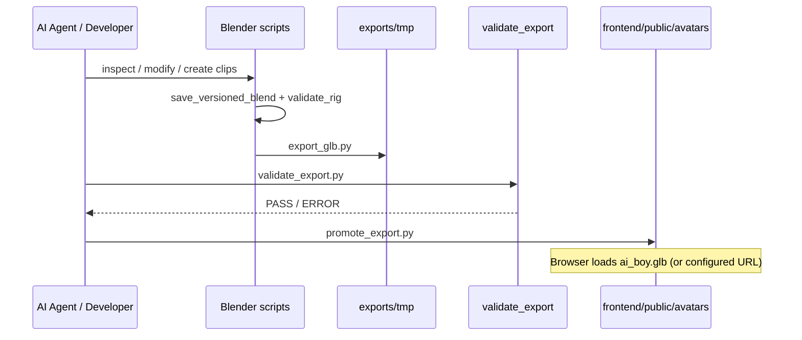
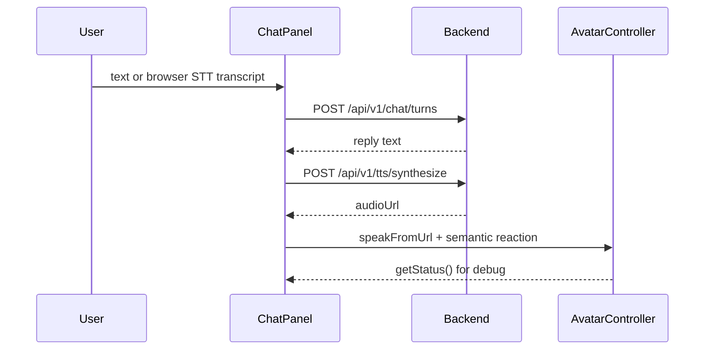
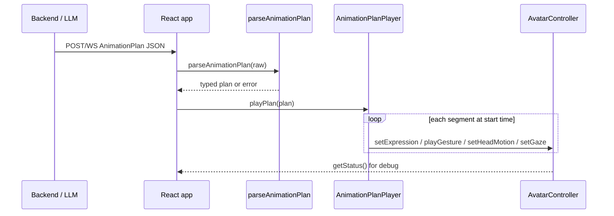
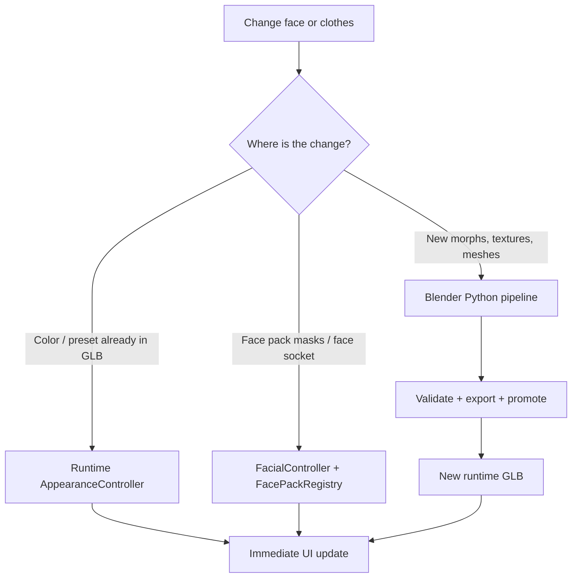
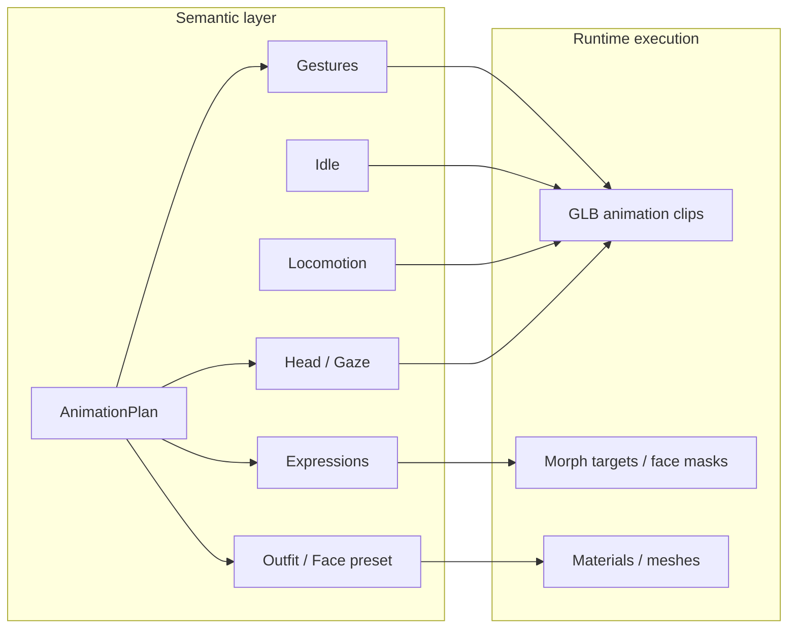

# Stylized Chatbot Avatar — Overall Architecture

ဤစာရွက်စာတမ်းသည် အပြန်အလှန်တုံ့ပြန်နိုင်သော **stylized** 3D chatbot avatar (Snapchat / Bitmoji-like look) အတွက် **project architecture** ဖြစ်သည်။ စနစ်၏ နယ်နိမိတ်များ၊ data စီးဆင်းမှုများ၊ နှင့် semantic runtime ကို စကားပြောခြင်း (text/voice)၊ စိတ်ကြိုက်ပြင်ဆင်နိုင်သော ရုပ်ထွက်များ (customized looks) နှင့် လိုအပ်ပါက အချိန်သတ်မှတ်ထားသော ညွှန်ကြားချက် ပလန်များ (timed instruction plans) သို့ မည်သို့တိုးချဲ့ထားသည်ကို ဖော်ပြထားသည်။

**လက်ရှိအခြေအနေ (2026-11-11):** Chat (စာသား) + TTS + browser STT တို့ကို ပို့ပြီးဖြစ်သည်။ Default runtime body မှာ `ai_boy.glb` ဖြစ်သည်။ `AnimationPlanPlayer`၊ wardrobe/appearance presets၊ နှင့် cloud/backend STT တို့မှာ **Planned** အဖြစ် ကျန်ရှိသည်။ အကောင်အထည်ဖော်မှုကို တဖြည်းဖြည်းချင်း (တည်ဆောက်ရင်း လေ့လာသည့်ပုံစံဖြင့်) ပြုလုပ်ပါသည်။ **Planned** ဟု မှတ်သားထားသော အရာများသည် အတည်ပြုပြီးသား architecture များဖြစ်ပြီး မပြီးပြတ်သေးသော ခန့်မှန်းချက်များ မဟုတ်ပါ။

**Product pivot (Phase 0):** အဓိက UX မှာ **စကားပြောဆိုခြင်း** (စာရိုက်ခြင်းကို ဦးစွာပြုလုပ်ပြီး၊ ထို့နောက် အသံ) ဖြစ်သည်။ ယခင် “သတင်းကြေညာသူ + AnimationPlan” လမ်းကြောင်းသည် အဓိက ထုတ်ကုန်၏ ပုံပြင် မဟုတ်တော့ဘဲ တရားဝင် **စိတ်ကြိုက် ရွေးချယ်နိုင်သော scripted mode** အဖြစ် ကျန်ရှိနေမည်ဖြစ်သည်။

<!-- ဆက်စပ် docs များ:

- [docs/architecture.md](architecture.md) — layer အနှစ်ချုပ်
- [docs/Overall_Architecture.md](Overall_Architecture.md) — ဤစာရွက်စာတမ်း၏ အင်္ဂလိပ်မူ
- [docs/avatar-art-contract.md](avatar-art-contract.md) — stylized look + bone/clip/morph contract
- [docs/blender-pipeline.md](blender-pipeline.md) — Blender → GLB automation
- [docs/avatar-spec.md](avatar-spec.md) — asset နှင့် semantic API မှတ်စုများ
- [AGENTS.md](../AGENTS.md) — coding agents များအတွက် အဆင့်တစ်ဆင့်ချင်း အကောင်အထည်ဖော်မှု စည်းမျဉ်း -->

---

## 1. Product Goal

အောက်ပါတို့ပါဝင်သည့် browser-based **interactive chatbot avatar** ကို တည်ဆောက်ပါ:

1. စစ်ဆေးအတည်ပြုထားသော **GLB** (skeleton + motion; ရုပ်ထွက်များကို Three.js ထဲတွင် လဲလှယ်နိုင်သည်) ထံမှ **stylized** လူပုံစံကို load လုပ်ရန်
2. **Semantic** ပြုမူဆောင်ရွက်ချက်များ (idle, talk reaction, gestures, expressions, head, gaze, locomotion, audio) ကို play ပြုလုပ်ရန်
3. UI ထံသို့ bones/clips များကို ချပြခြင်းမရှိဘဲ **text** ကို ဦးစွာအသုံးပြု၍ လည်းကောင်း၊ ထို့နောက် **voice in/out** (STT / TTS) တို့ဖြင့်လည်းကောင်း အသုံးပြုသူနှင့် စကားပြောဆိုရန်
4. Scripted စွမ်းဆောင်ရည်များ (ယခင် legacy presenter path) အတွက် အချိန်သတ်မှတ်ထားသော **AnimationPlan** ကို စိတ်ကြိုက်လက်ခံရန်
5. ရှင်းလင်းသော asset + runtime နယ်နိမိတ်များမှတစ်ဆင့် **visual customization** (materials / accessories / face packs) များကို ပံ့ပိုးပေးရန်
6. Developer + AI coding agent များအတွက် ထိန်းသိမ်းရလွယ်ကူအောင် ထားရှိရန် (တည်ဆောက်ပုံအတွက် Blender Python၊ ပြုမူဆောင်ရွက်ချက်များအတွက် TypeScript/JSON)

---

## 2. Core Principles

1. **Edit sources, not compiled GLBs** — JSON, TypeScript, နှင့် Blender Python တို့သည် အဓိကဖြစ်သည်; runtime GLBs (`ai_boy.glb`, စိတ်ကြိုက် `presenter.glb` / `face.glb`) မှာ export ထုတ်ထားခြင်း ဖြစ်သည်။
2. **Blender authors assets; the browser runs them** — request path ထဲတွင် Blender မပါဝင်ပါ။
3. **Semantic commands only** — `playGesture("emphasize")`, `setExpression("serious")` များကိုသာ သုံးရမည်၊ bone indexes သို့မဟုတ် clip array positions များကို မည်သည့်အခါမျှ မသုံးရပါ။
4. **Separate look from behavior** — mesh/materials/morphs/face packs နှင့် gestures/idle/locomotion/plans တို့ကို သီးခြားခွဲထုတ်ထားသည်။
5. **Inspect → backup → modify → validate → export temp → promote** စနစ်ဖြင့် asset ပြောင်းလဲမှုများကို ပြုလုပ်ရန်။
6. **Backend sends intents, not renderer details** — chat replies, TTS audio URLs, emotion/gesture/head/gaze (+ နောက်ပိုင်း outfit/face presets) တို့ကိုသာ ပို့မည်၊ Mixamo bone paths သို့မဟုတ် Three.js objects များကို မည်သည့်အခါမျှ မပို့ပါ။
7. **Grow in phases** — local runtime ကို ဦးစွာပြုလုပ်မည်; ထို့နောက် chat → TTS → STT → skins (အောက်ပါ roadmap ကိုကြည့်ပါ)။
8. **Stylized over photoreal** — Cartoon အချိုးအစားများနှင့် soft/flat materials များကို သုံးမည်; [avatar-art-contract.md](avatar-art-contract.md) ကိုကြည့်ပါ။

---

## 3. System Context



### Roadmap (learning-sized phases)

| Phase | Focus | Status |
| --- | --- | --- |
| 0 | Product goal + art/naming contract | Done |
| 1 | Stylized avatar art + framing; runtime GLB (`ai_boy.glb`) | Done |
| 2 | Text chat loop → avatar talk/idle | Done |
| 3 | TTS → `AudioController` + lip sync / mouth | Done |
| 4 | Voice in — browser STT (Web Speech mic) | Done |
| 4b | Cloud / backend STT | Planned |
| 5 | Three.js skins / material presets (`AppearanceController`) | Planned |
| 6 | Polish (streaming, barge-in, richer gestures, plan player UX) | Planned |

---

## 4. Logical Architecture



| Layer | Responsibility |
| --- | --- |
| Web | Pages, chat UI, debug UI, config, STT mic hook; နောက်ပိုင်း plan fetch UI |
| Avatar runtime | Semantic API → mixers, morphs/face packs, bones, idle, locomotion, audio, lip sync |
| Definitions | Gesture/expression/idle/locomotion အမည်များ, material/outfit presets များ, schemas များ |
| Blender authoring | Rig, mesh, facial morphs သို့မဟုတ် face assets, အဝတ်အစား, export |
| Backend (shipped core) | Chat turns (LLM), TTS, sample/generate `AnimationPlan` helpers |
| Backend (planned) | Cloud STT; plan player က စားသုံးမည့် ပိုပြည့်စုံသော plan orchestration |

---

## 5. Repository Layout (actual)

npm app သည် **`frontend/`** ထဲတွင် ရှိသည် (`apps/` monorepo ထဲတွင် မဟုတ်ပါ)။ API သည် **`backend/`** ထဲတွင် ရှိသည်။

```text
AI_3D_Avatar/
├── frontend/                              # Vite + React + R3F
│   ├── public/avatars/
│   │   ├── ai_boy.glb                     # Default runtime body (avatarConfig.modelUrl)
│   │   ├── presenter.glb                  # Contract stand-in / alternate
│   │   ├── face.glb                       # Optional face socket asset
│   │   └── face/masks/                    # Optional expression face-pack textures
│   ├── public/audio/
│   └── src/
│       ├── features/avatar/               # R3F scene + debug UI
│       ├── features/chat/                 # Chat panel, STT, TTS reaction helpers
│       ├── services/avatar/               # AvatarRuntime, controllers
│       ├── types/                         # AvatarController, AnimationPlan
│       └── constants/
├── backend/                               # FastAPI clean architecture
│   └── app/                               # chat, tts, plans, health routes
├── blender/
│   ├── source/presenter.blend             # Learning / contract authoring source
│   ├── scripts/                           # inspect, validate, export, modify, …
│   ├── definitions/                       # bone rename maps, etc.
│   └── exports/                           # tmp + candidates (e.g. ai_boy_rigged_textured.*)
├── docs/
│   ├── Overall_Architecture.md            # အင်္ဂလိပ်မူ
│   └── overall_architecture_burmese.md    # ဤမြန်မာမူ
├── AGENTS.md
└── README.md
```

---

## 6. End-to-End Data Flows

### 6.1 Asset pipeline (Blender → browser)



### 6.2 Chat turn → speak (shipped)



### 6.3 Backend instruction array → avatar performance (target)



**Status today:** `AnimationPlan` types နှင့် `parseAnimationPlan` တို့ ရှိနှင့်ပြီးဖြစ်သည် (frontend + backend)။ Backend တွင် sample/generate plan helpers ရှိသည်။ **AnimationPlanPlayer** နှင့် frontend “play plan” consumer တို့မှာ **Planned** ဖြစ်သည်။

### 6.4 Appearance change (face / clothes)



---

## 7. Semantic Runtime API

UI, debug panel, chat adapters, plan player, နှင့် အနာဂတ် backend adapters များသည် ဤ surface ကိုသာ အသုံးပြုရမည် (အမည်များ တိုးလာနိုင်သည်; indexes များကို မည်သည့်အခါမျှ ဖော်ပြမည်မဟုတ်ပါ):

| Command | Purpose | Status |
| --- | --- | --- |
| `playGesture(name)` | တစ်ကြိမ်ပြုလုပ်မည့် body gesture | Done |
| `setExpression(name)` | Facial morph / face-pack preset | Done |
| `setHeadMotion(name)` | Nod / turn / tilt / shake | Done |
| `setGaze(target)` | ကြည့်ရှုမည့် target | Done |
| `setIdle(name)` | Looping idle pose | Done |
| `startLocomotion(name)` / `stopLocomotion()` | In-place walk cycles | Done |
| `startSpeaking()` / `stopSpeaking()` | Speech state hooks | Done |
| `loadAudio` / `playAudio` / `pauseAudio` / `stopAudio` | Local audio | Done |
| `unlockAudio()` / `speakFromUrl(url)` | TTS-friendly playback | Done |
| `reset()` | Idle baseline သို့ ပြန်သွားရန် | Done |
| `playPlan(plan)` | အချိန်သတ်မှတ်ထားသော segment array ကို run ရန် | **Planned** |
| `setOutfit(id)` / `setFacePreset(id)` | Appearance presets များ | **Planned** |

လက်ရှိ gesture / expression / idle / locomotion / head / gaze အမည်အစုအဝေးများသည် `frontend/src/types/animation.ts` နှင့် `AnimationRegistry.ts` ထဲတွင် ရှိသည်။

---

## 8. Backend Instruction Plans

### 8.1 Contract

Backend (သို့မဟုတ် mock file) သည် bone keyframes စာရင်းကို ပို့ခြင်းမဟုတ်ဘဲ **အချိန်သတ်မှတ်ထားသော segments array** ကို ပေးပို့သည်။

```json
{
  "segments": [
    {
      "start": 0,
      "end": 2.0,
      "emotion": "serious",
      "gaze": "camera"
    },
    {
      "start": 2.0,
      "end": 4.5,
      "gesture": "emphasize",
      "headMotion": "nod",
      "emotion": "serious"
    },
    {
      "start": 4.5,
      "end": 7.0,
      "emotion": "positive",
      "gesture": "openHand",
      "headMotion": "tiltLeft"
    }
  ]
}
```

နောက်ပိုင်းတွင် ထည့်သွင်းနိုင်သော စိတ်ကြိုက် fields များ (တူညီသော semantic style):

```json
{
  "start": 0,
  "end": 10,
  "emotion": "neutral",
  "outfit": "suit_navy",
  "facePreset": "presenter_a"
}
```

### 8.2 Rules

- အချိန်များသည် plan စတင်ချိန်မှစ၍ စက္ကန့်များဖြစ်သည် (`start` ≤ `end`)။
- မသိရှိသော semantic အမည်များကို `parseAnimationPlan` မှ ငြင်းပယ်ပါမည်။
- Player သည် segment တစ်ခုစီကို `start` ချိန်တွင် `AvatarController` ပေါ်သို့ map လုပ်ပေးသည် (ဒီဇိုင်းဆွဲထားသည့်အတိုင်း `end` ချိန်တွင် ရှင်းလင်းခြင်း/အစားထိုးခြင်း ပြုလုပ်နိုင်သည်)။
- Backend သည် morph indexes, clip indexes, သို့မဟုတ် Three.js node names များကို ပေးပို့ခြင်း မပြုရပါ။

### 8.3 Implementation stages

| Stage | Deliverable |
| --- | --- |
| Done | `AnimationPlan` / `AnimationSegment` types |
| Done | `parseAnimationPlan` + unit tests (frontend + backend) |
| Done | Backend plan helpers (`/plans/sample`, generate routes) |
| Done | Chat UI က သုံးသော Chat + TTS HTTP (အဓိက product path) |
| Planned | `AnimationPlanPlayer` + controller ပေါ်ရှိ `playPlan` |
| Planned | Debug “load sample plan” ခလုတ် / frontend plan consumer |
| Later | TTS clock နှင့် ချိန်ညှိထားသော LLM plans; streaming / barge-in |

---

## 9. Customized Face

### 9.1 Goals

- Runtime ကို ပြန်မရေးရဘဲ ဇာတ်ကောင်၏ မျက်နှာကို လဲလှယ်ရန် သို့မဟုတ် ပိုမိုကောင်းမွန်အောင် ပြုလုပ်ရန်
- တည်ငြိမ်သော morph target အမည်များ **သို့မဟုတ်** face-pack masks မှတစ်ဆင့် expressions များကို မောင်းနှင်ရန်
- မျက်နှာများစွာ ရှိနေပါက UI/backend မှ **face preset** ကို စိတ်ကြိုက် ရွေးချယ်နိုင်ရန်

### 9.2 Architecture split

| Concern | Owner |
| --- | --- |
| Face mesh, textures, တကယ့် blendshapes များ | Blender (authoring) |
| Morph name contract | `blender/scripts/contracts.py` + docs |
| Expression weights / face-pack masks | `FacialController`, `FacePackRegistry`, `FaceMaskLayer` |
| `Head` ပေါ်ရှိ စိတ်ကြိုက် သီးခြား face mesh | `avatarConfig.faceUrl` + runtime attach |
| Preset “Face A/B” ကို ရွေးချယ်ခြင်း | **Planned** `AppearanceController` / definitions JSON |

### 9.3 Paths to a custom face

1. **Author morphs on current character** — Blender ထဲတွင် တကယ့် shape keys များကို sculpt လုပ်ပါ; contract အမည်များကို ထိန်းသိမ်းပါ; export → promote လုပ်ပါ။
2. **Replace character** — Rig လုပ်ထားသော GLB/FBX (ဥပမာ Mixamo) ကို import လုပ်ပါ၊ bones များကို အမည်ပြောင်းပါ၊ morphs/textures များကို ထည့်ပါ၊ ထုတ်လုပ်ပါ (AI Boy path)။
3. **Face socket + face pack (shipped option)** — သီးခြား `face.glb` နှင့်/သို့မဟုတ် mask textures; blank stylized heads အတွက် `useFacePack` ဖြင့် mask expressions ကို ဖွင့်နိုင်သည် (painted characters များတွင် ပိတ်ထားရမည်)။
4. **Runtime face preset (Planned)** — `setFacePreset("id")` ဖြင့် ရွေးချယ်နိုင်သော head meshes သို့မဟုတ် morph/texture sets အများအပြား။

### 9.4 Constraints

- Mixamo bodies များတွင် တကယ့် facial morphs များ ပါဝင်လေ့မရှိပါ; contract/UX အတွက် stubs / face pack ကို သုံးသည်။
- Photo-to-face pipelines များသည် runtime ၏ **ပြင်ပ** တွင်သာ ရှိသည် (external tool → import pipeline)။
- Morph target indexes များကို React components များထဲတွင် ကြိုကြားကြိုကြား မထည့်ပါနှင့်။

---

## 10. Avatar Clothing

### 10.1 Goals

- Rig သို့မဟုတ် semantic API ကို မပျက်စီးစေဘဲ ဝတ်စုံ/အဝတ်အစား ရုပ်ထွက်ကို ပြောင်းလဲရန်
- GLB တွင် materials များကို ဖော်ပြထားပြီး ဖြစ်ပါက ကာလာ/presets များအတွက် **runtime overrides** များကို ပိုမိုဦးစားပေးရန်
- အဝတ်အစားများတွင် meshes, UVs, သို့မဟုတ် texture sets သစ်များ လိုအပ်ပါက Blender ကို အသုံးပြုရန်

### 10.2 Architecture split

| Concern | Owner |
| --- | --- |
| Clothing meshes, UVs, textures, material slots | Blender |
| Material အမည်ပေးခြင်း (`Suit`, `Shirt`, …) | Asset contract / definitions |
| Runtime တွင် ကာလာပြောင်းခြင်း / preset ကို လဲလှယ်ခြင်း | **Planned** `AppearanceController` |
| Materials သစ်များကို GLB ထဲသို့ bake လုပ်ခြင်း | `modify_materials.py` + export pipeline |

### 10.3 Paths to change clothes

1. **Color change (simple)** — Blender `modify_materials.py` သို့မဟုတ် runtime material color override (UI ထဲတွင် **Planned**)။
2. **Outfit preset** — အမည်ပေးထားသော material/texture sets သို့မဟုတ် ဝှက်ထားသော mesh groups များ; `setOutfit("suit_navy")`။
3. **Full wardrobe swap** — တူညီသော armature တွင် skin လုပ်ထားသည့် သီးခြား clothing meshes များ; runtime တွင် ပြသ/ဝှက် သို့မဟုတ် လဲလှယ်ပါ။

### 10.4 Constraints

- အသားအရေ + အဝတ်အစား တို့ကို ပေါင်းစပ်ထားသည့် တစ်ခုတည်းသော atlas texture သည် ကာလာပြောင်းလဲခြင်းကို ကန့်သတ်စေသည်; ဝတ်စုံသည် အရေးကြီးပါက Blender ထဲတွင် materials များကို ခွဲခြားပါ။
- Backend သည် plan segment ထဲတွင် `outfit` ကို တောင်းဆိုနိုင်သည်; ၎င်းသည် mixer ထဲသို့ shader graphs သို့မဟုတ် texture URLs များကို ကန်းကန်းဆန်းဆန်း မပို့ရပါ (ခွင့်ပြုချက်စာရင်းနှင့် စစ်ဆေးအတည်ပြုပါ)။

---

## 11. Blender Automation Strategy

Authoring ကို ဆော့ဖ်ဝဲဖြင့် ထိန်းချုပ် ရေးသားနိုင်အောင် ထားရှိသည်:

```text
inspect_scene → modify_* / create_animation / apply_rename_map
  → save_versioned_blend → validate_rig
  → export_glb (tmp) → validate_export → promote_export
```

အဓိက scripts များကို `blender/scripts/` အောက်တွင် ထားရှိသည် (`automation/` ဟု ဖော်ပြထားသော MVP docs များသည် ဤ folder ကို ဆိုလိုခြင်းဖြစ်သည်)။ [docs/blender-pipeline.md](blender-pipeline.md) ကိုကြည့်ပါ။

`frontend/` မှ npm helpers များ: `avatar:inspect`, `avatar:validate-rig`, `avatar:export`, `avatar:validate-export`, `avatar:promote`, `avatar:release`, `avatar:scaffold`, `avatar:export-mixamo`, `avatar:import-rigged`။

---

## 12. Animation and Appearance Strategy



- **Clips** — idle, gestures, head motions, locomotion (Blender သို့မဟုတ် stub generators)။
- **Morphs / face packs** — facial expressions (နှင့် TTS အတွင်း mouth amplitude / lip sync)။
- **Materials/meshes** — အဝတ်အစားနှင့် မျက်နှာ ရုပ်ထွက်။
- **Plans** — backend/LLM မှ အချိန်သတ်မှတ်ထားသော စီမံခန့်ခွဲမှု (optional path)။

---

## 13. Phase Map

| Track | Focus | Backend? | Status |
| --- | --- | --- | --- |
| **Foundation** | GLB load, semantic API, idle/gesture/expression/head, local audio, debug panel, Blender pipeline | No | Done |
| **Conversation** | Chat UI, FastAPI chat turns + LLM, TTS playback, browser STT, reply reactions, lip sync | Yes | Done |
| **Motion expansion** | Richer gestures, idle variants, locomotion | No | Done (core set) |
| **Character / face** | AI Boy body GLB; optional face socket + face pack | No | Done (baseline); polish ongoing |
| **Next architecture slices** | `AnimationPlanPlayer`, sample-plan UI, appearance presets, cloud STT | Partial / Planned | Next |
| **Later polish** | Streaming, barge-in, subtitles, multilingual | Yes | Planned |

Conversation သည် avatar ကို semantic fields များဖြင့်သာ မောင်းနှင်ရမည်။ Scripted `AnimationPlan` သည် optional အဖြစ် ကျန်ရှိသည်။

---

## 14. Web and Runtime Notes

- Per-frame လုပ်ငန်းစဉ်များသည် `AvatarRuntime.update` / `useFrame` ထဲတွင်သာ ရှိနေရမည် — frame တိုင်းတွင် React `setState` ကို မသုံးရပါ။
- Debug panel သည် status ကို တစ်စက္ကန့်လျှင် အကြိမ်အနည်းငယ်သာ နမူနာယူပြီး `AvatarController` ကိုသာ ခေါ်ဆိုသည်။
- avatar feature ကသာ `AvatarRuntime` ကို တည်ဆောက်ပါသည် (`features/avatar` ကိုကြည့်ပါ)။ Chat သည် hooks/helpers မှတစ်ဆင့် တူညီသော controller ကို သုံးသည်။
- မရှိသော clips/morphs/materials မှုများသည် သတိပေးချက်များ ထုတ်ပေးမည်ဖြစ်ပြီး ဖြစ်နိုင်ပါက ဘေးကင်းသော no-ops များအဖြစ် ပြုမူပါမည်။

---

## 15. Testing and Validation

- **Unit:** definition validation, `parseAnimationPlan`, registries, state machine, face pack registry.
- **Blender:** `inspect_scene`, `validate_rig`, `validate_export` (PASS/WARNING/ERROR စာကြောင်းများ)။
- **Manual:** avatar loads, gestures, expressions, idle/locomotion, chat + TTS + mic STT, plan playback (တည်ဆောက်ပြီးပါက), outfit/face presets (တည်ဆောက်ပြီးပါက)။
- **Rule:** ကျရှုံးသွားသော export validation သည် အလုပ်လုပ်နေသော runtime GLB ပေါ်သို့ မည်သည့်အခါမျှ promote မလုပ်ရပါ။

---

## 16. Engineering Rules

- Avatar logic အားလုံးကို React component တစ်ခုတည်းထဲတွင် မထည့်ပါနှင့်။
- UI/backend payloads များထဲတွင် clip indexes သို့မဟုတ် raw morph indexes များကို မသုံးပါနှင့်။
- Backup/validation မပါဘဲ authoring `.blend` ဖိုင်များ သို့မဟုတ် runtime GLB ကို အစားထိုး မရေးပါနှင့်။
- ပုံမှန် browser interactions များအတွက် Blender ကို run ခြင်း မပြုပါနှင့်။
- အဝတ်အစား ကာလာအတွက် runtime material/outfit presets များကို ဦးစားပေးပါ; ပုံသဏ္ဍာန်ဆိုင်ရာ အဝတ်အစား/မျက်နှာ အလုပ်များအတွက် Blender ကို သုံးပါ။
- Backend plans နှင့် chat reactions များသည် semantic သာ ဖြစ်ရမည်။

---

## 17. Definition of Done (architecture milestones)

### Foundation + conversation (shipped)

- [x] Local Vite app မှ runtime GLB (`ai_boy.glb` default) ကို load လုပ်နိုင်ခြင်း
- [x] Semantic runtime API + debug panel
- [x] Blender inspect → validate → export → promote pipeline
- [x] `AnimationPlan` types + `parseAnimationPlan`
- [x] FastAPI chat turns + TTS ကို chat UI မှ သုံးနိုင်ခြင်း
- [x] Chat panel ပေါ်ရှိ browser STT mic
- [x] ပရောဂျက် architecture စာရွက်စာတမ်း (ဤဖိုင် + အင်္ဂလိပ်မူ)

### Planned next

- [ ] `AnimationPlanPlayer` + `playPlan`
- [ ] JSON ဖိုင် သို့မဟုတ် paste ထားခြင်းမှ Debug/mock plan
- [ ] Appearance API: outfit နှင့်/သို့မဟုတ် face preset
- [ ] Cloud / backend STT (optional; browser STT အလုပ်လုပ်ပြီးဖြစ်သည်)
- [ ] Asset လမ်းညွှန်ချက် polish: အဝတ်အစားများအတွက် split materials; ပိုကြွယ်ဝသော face presets

---

## 18. Final Division of Responsibilities

| System | Owns |
| --- | --- |
| **Blender** | Geometry, rig, facial morph authorship, clothing meshes/textures |
| **Blender Python** | Inspect, safe modify, validate, export |
| **GLB** | Runtime ဖြန့်ဖြူးရေး format |
| **JSON / TS definitions** | အမည်များ, presets များ, schemas များ |
| **AvatarRuntime** | Semantic → clips/morphs/face packs/materials/audio |
| **React** | UI, chat lifecycle, STT mic, plan fetch UI (တည်ဆောက်ပြီးပါက) |
| **Backend** | Chat orchestration, LLM, TTS; optional plan helpers |
| **LLM** | Chat replies; နောက်ပိုင်း optional အဆင့်မြင့် semantic plans |

ရည်ရွယ်ချက်မှာ browser ထဲတွင် DCC tools များကို ပြန်လည်တည်ဆောက်ရန် မဟုတ်ပါ။ ရည်ရွယ်ချက်မှာ **ရှင်းလင်းသော နယ်နိမိတ်** တစ်ခုရှိရန်ဖြစ်သည်: ရုပ်ထွက်များကို Blender တွင် ဖန်တီးပါ၊ ပြုမူဆောင်ရွက်ချက်များကို semantic commands (နှင့် စိတ်ကြိုက် plans) များဖြင့် မောင်းနှင်ပါ၊ နှင့် backend ကို bones နှင့် shaders များနှင့် ကင်းလွတ်အောင် ထားရှိပါ။
